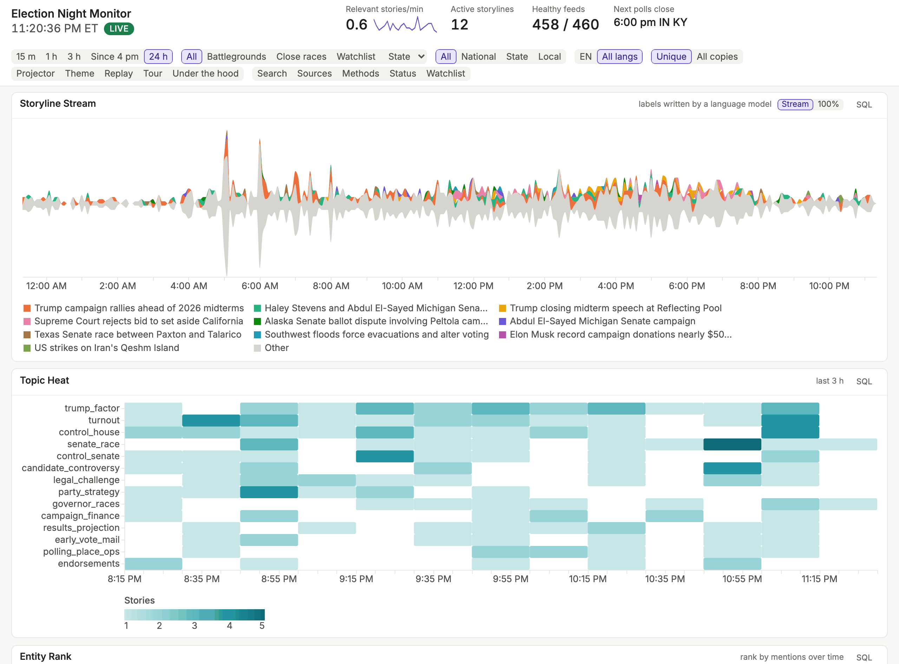

# Election Night News Monitor

**Documentation: <https://dchud.github.io/electionnight/>**

> **Agent-coded, for teaching.** An AI coding agent, Claude Code, wrote this
> software for teaching purposes. It is not intended as production software,
> and it does not report official election results.

## Purpose

This monitor shows how news outlets cover an election as it happens. It reads
a few hundred news feeds, runs each story through a series of parsers, stores
the results in a [DuckLake](https://ducklake.select/), and shows them on a live
dashboard.

The parsers record:

- election relevance, and whether a story is national, state, or local
- topics
- people, organizations, parties, offices, and ballot measures
- places, resolved to FIPS codes
- the tone of each article, and its tone toward named entities
- multilingual embeddings and storyline clusters
- race calls as news outlets report them

The dashboard shows short-term and medium-term trends, and its charts and
counts open the stories behind them. Focus modes narrow the view to
battleground states, close races, a watchlist, or one state.

[](https://dchud.github.io/electionnight/tour/)

The [tour](https://dchud.github.io/electionnight/tour/) has more screens.

## Context

The monitor was built for one evening: the US midterm elections on November 3,
2026, during a data science class on managing unstructured data. News stories
are the unstructured data, and DuckLake is a main topic of the class.

The "Under the hood" pages, at `/under`, show the same data from the inside:
tables, snapshots, Parquet files, queries, model output, and API costs. The
[class walkthrough](https://dchud.github.io/electionnight/walkthrough/) is the
script for teaching from them.

Claude Code wrote the code, tests, and documentation from the specification in
[`SPEC.md`](SPEC.md), starting two days before the election. A person directed
the work and decided what to merge. [`CLAUDE.md`](CLAUDE.md) holds the
instructions the agent followed.

## Limits

- **One machine.** It runs on one laptop as two processes, a single writer and
  a read-only dashboard, with no failover.
- **No accounts.** It has no authentication and is meant for localhost, or for
  a second screen on a local network.
- **One event.** It was built to a fixed deadline, with no releases, support,
  or upgrade path.
- **Model output can be wrong.** Language models produce much of what it shows,
  including relevance, topics, entities, tone, storylines, and race calls.
- **No official results.** Race calls are claims reported in the news, labeled
  and cited as such. It holds no vote counts.

## Running it

It was built and run on a Mac, with [uv](https://docs.astral.sh/uv/) and Python
3.12. It calls the Claude API, which costs money. At 80% of
`LLM__DAILY_USD_CAP` in `.env`, low-signal sources move to keywords and other
calls continue. At `LLM__HARD_USD_CAP`, a total across all days, only briefs
still call the API.

```bash
uv sync
cp .env.example .env              # then set ANTHROPIC_API_KEY
uv run monitor init
uv run monitor ref all            # reference data; part of it calls the API
caffeinate -is uv run honcho start pipeline web
```

The dashboard is at <http://127.0.0.1:8000>. `uv run monitor --help` lists
every operating command.

## Where to read more

The [documentation site](https://dchud.github.io/electionnight/) has these
pages:

| Page | What it holds |
|---|---|
| [Tour](https://dchud.github.io/electionnight/tour/) | Screens of the dashboard and the "Under the hood" pages |
| [Class walkthrough](https://dchud.github.io/electionnight/walkthrough/) | The class script for the "Under the hood" pages |
| [Methods](https://dchud.github.io/electionnight/methods/) | How each number is produced, and its limits |
| [Run of show](https://dchud.github.io/electionnight/run_of_show/) | Operating steps for election night, and what to do when something fails |
| [Verification log](https://dchud.github.io/electionnight/verify_log/) | Facts checked during the build, and where the specification differs |
| [Colophon](https://dchud.github.io/electionnight/colophon/) | The tech stack, the data sources, and the published work the monitor uses |
| [Third-party notices](https://dchud.github.io/electionnight/third_party_notices/) | What the MIT license covers, and the licenses of everything else |

The repository holds two more:

| File | What it holds |
|---|---|
| [`SPEC.md`](SPEC.md) | Requirements, data model, and dashboard behavior |
| [`CLAUDE.md`](CLAUDE.md) | Commands, key files, and conventions |

## License

The MIT license in [`LICENSE`](LICENSE) covers this project's own code and
documentation. It does not cover third-party material in this repository:
vendored frontend code, fonts, map data, lean labels, race ratings, and
Wikipedia excerpts in test fixtures keep their own terms, listed in the
[third-party notices](https://dchud.github.io/electionnight/third_party_notices/).
