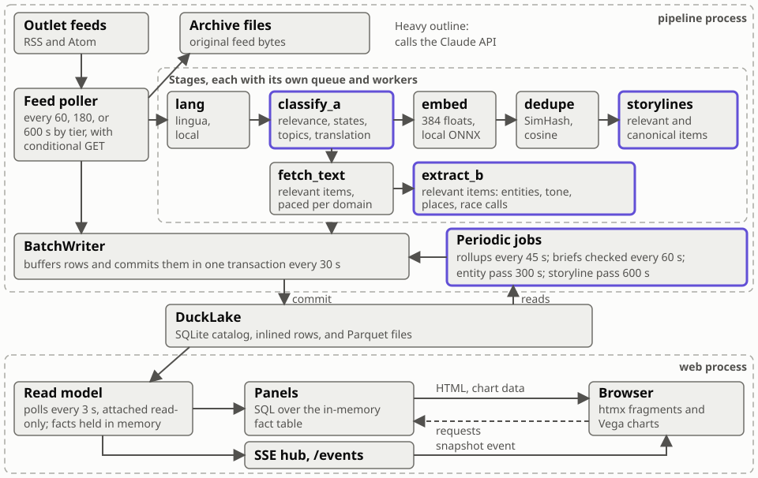
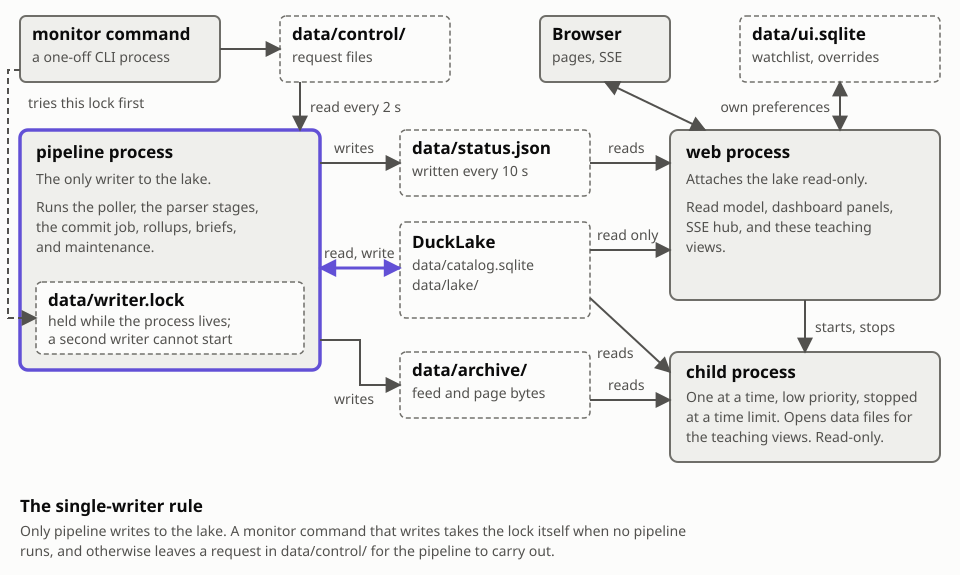
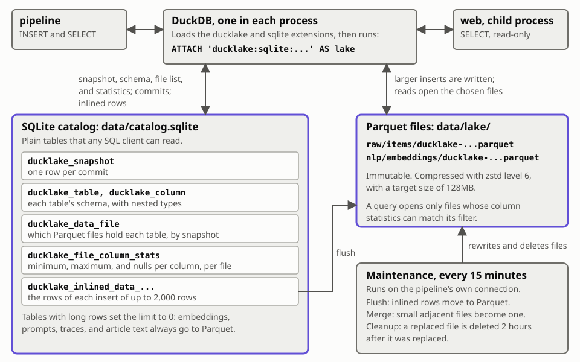

# Methods

This monitor reads news feeds during the 2026 US midterm elections and shows
how outlets cover the night. It reports what news outlets publish. It does not
report official results.

## From feed to screen

Live view: [trace one article](/under/trace).

The poller reads each outlet's feeds and hands new items to the parser stages.
Every row the pipeline writes goes through one `BatchWriter`, which commits a
batch to DuckLake every 30 s. Maintenance runs flush and merge directly on the
same connection, with no `BatchWriter`. The web process polls the catalog every
3 s, copies what changed into an in-memory fact table, and tells connected
browsers over server-sent events. The browser then asks for new fragments and
chart data.

`classify_a` feeds two branches. Every item goes on to `embed`, `dedupe`, and
`storylines`, and `storylines` keeps only relevant, canonical items. Relevant
items also go to `fetch_text` and `extract_b`.

Every row is append-only. A correction is a new row with a newer `created_at`,
and readers take the latest row. Each parser row records `parser` and
`parser_version`. To see them for one story, open its article page and expand
"Raw parser output".

## Processes and the single-writer rule

Live views: [feeds](/under/feeds) and [storage](/under/storage).

One process at a time writes to the lake, and it holds `data/writer.lock` while
it does. While `pipeline` runs, it is that process. A `monitor` command that
writes tries the same lock first. With no pipeline running, the command holds
the lock and writes directly. With a pipeline running, the command leaves a
request file in `data/control/`, the pipeline reads it within 2 s and carries
it out, and a result file comes back there.

The dashboard process, `web`, attaches the lake read-only and refreshes when a
new snapshot appears. It never writes to the lake. Its only database file is
`data/ui.sqlite`, which holds the watchlist and the battleground overrides.

The teaching views run anything that opens a data file in a short-lived child
process: at a lowered priority, stopped at a time limit, and attached
read-only. Scans run one at a time. The SQL console runs its own queries one at
a time, so a console query can run beside a scan. A busy scan makes a page say
so at once and offer a retry. The pipeline reports its state through
`data/status.json` every 10 s, because the web process cannot read another
process's memory.

## Collection

Live view: [feeds](/under/feeds).

Each outlet has a polling tier of 60, 180, or 600 s, with 15% jitter. Requests
send `If-None-Match` and `If-Modified-Since`, so an unchanged feed answers 304
with no body. At most 2 requests run per domain at once, each with a 20 s
timeout.

A failed poll doubles the delay, up to 8 times the tier and never over 900 s.
After 5 failures in a row, the feed's circuit opens and it is tried every 900
s. This state lives in the pipeline's memory, so a restart clears it.

An item's id is a hash of its canonical URL, so one article is one item.
`raw.items` keeps its first sighting, and its `source_id` is the first feed to
serve it. `raw.sightings` records each feed that served it, and each change of
title. The original bytes go to hourly compressed files in `data/archive/`, and
`raw.archive_index` records where each one sits.

## Parser stages

Live views: [models](/under/models) and [trace one article](/under/trace).

| Stage | Takes | Batch | Workers | Runs on |
|---|---|---|---|---|
| `lang` | every item | 64 | 1 | this laptop, `lingua` |
| `classify_a` | every item | 10 | 6 | Claude, or keyword lists |
| `embed` | every classified item | 32 | 1 | this laptop, ONNX |
| `dedupe` | every embedded item | 64 | 1 | this laptop |
| `storylines` | relevant, canonical items | 32 | 1 | this laptop, Claude for labels |
| `fetch_text` | relevant items | 1 | 16 | this laptop, over HTTP |
| `extract_b` | relevant items | 1 | 8 | Claude |

An item is relevant when `election_relevant` is true and `relevance_conf` is at
least 0.5.

### Retries and backfill

A stage that fails on a batch retries each item after 5 s and again after 10 s,
each with up to 20% jitter. After 3 attempts it records `status = 'error'` in
`nlp.parser_runs`. Each stage also pulls older work from the lake, behind live
items, by finding items with no finished run of its current parser version.
Items waiting on that path do not count as lag.

### Load shedding

When the oldest live item waiting at `lang`, `classify_a`, `embed`, `dedupe`,
or `storylines` has waited over 120 s, the pipeline pauses backfill and halves
the embedding rate. It resumes under 60 s. Full-text fetching is left out,
because it is paced per domain on purpose. `/status` shows when it is shedding.

### Language detection

`lingua` reads the first 1,000 characters of the title and summary. The feed's
declared language stands unless the detector has a confidence of at least 0.75
on text of at least 40 letters. A Chinese, Japanese, or Korean character counts
as 3 letters. `method` records which applied: `feed`, `detected`, or
`feed+detected`.

### Classification

Items go to the bulk model 10 at a time, with low effort and no extended
thinking. A batch that is refused, truncated, or fails validation twice is
split in half and tried again. A single item that still fails falls to keyword
lists, which set `method = 'keywords'`. At 80% of the daily cap, low-signal
sources use keywords too. A batch's `item_ref` values tie each answer to its
item.

### Embeddings

`intfloat/multilingual-e5-small` runs on the CPU through ONNX, with 4 threads,
in batches of 32. It uses 40% of the time, so collection keeps running. The
text is `passage: ` followed by the English title and summary, so stories in
different languages land near each other. A search uses the `query: ` prefix.
Each vector has 384 values. DuckLake rejects fixed-size arrays, so
`nlp.embeddings.vec` is stored as `FLOAT[]`, and a query casts it to
`FLOAT[384]` to use array functions.

### Dedupe

An item is compared with items seen within 36 hours.

1. **Title.** A title is lowercased, stripped of punctuation and any trailing
   outlet name, and cut into words and word pairs, or character pairs for
   Chinese, Japanese, and Korean. Each token's 64-bit `xxh64` hash votes on
   each bit of a 64-bit SimHash. A title of under 7 tokens gets no hash,
   because short titles such as "Live updates" repeat across unrelated stories.
   Formula (1) gives bit $k$ of the hash $H$, where $w$ runs over the title's
   tokens and $b_k(w)$ is bit $k$ of the token's `xxh64` hash.
2. **Title match.** Two hashes match at a Hamming distance of 3 or less, if
   they pass a place check, because a template can change only the state. Two
   items fail that check only when both name states and share none, so an item
   with no state passes it. An identical title that fails the check still
   matches if the two texts reach a cosine of 0.95, because a copy of one story
   can be tagged with each outlet's state.
3. **Embedding match.** Otherwise an item matches at a cosine of at least 0.95,
   on the same published day, if the two also pass the place check.

Formula (1) is the title hash, (2) is the title match, where $d$ counts the
bits that differ, and (3) is the embedding match, where $u$ and $v$ are the two
items' vectors.

$$
H_k =
\begin{cases}
1 & \text{if } \sum_{w} \bigl(2\,b_k(w) - 1\bigr) > 0 \\
0 & \text{otherwise}
\end{cases}
\qquad k = 0, \dots, 63 \tag{1}
$$

$$
d(H_a, H_b) \le 3 \tag{2}
$$

$$
\cos(u, v) = \frac{u \cdot v}{\lVert u \rVert \, \lVert v \rVert} \ge 0.95
\tag{3}
$$

A relevant item joins only groups a relevant item started, so the canonical
copy of a relevant story is relevant. `nlp.dup_groups.method` says
`title_hash`, `embedding`, or `none`. A row saying `url` was written by an
earlier parser and means no match was found; no URL was compared. A
`similarity` of 1.0 on a `title_hash` row is a placeholder, because no cosine
decided that match.
`nlp.cluster_decisions` keeps the nearest similarity and the SimHash distance
for each decision.

### Storylines

Clustering is online and takes items in the order they were seen. An item joins
the nearest storyline whose centroid has a cosine of at least 0.92 with it,
among storylines with an item in the last 8 hours. Otherwise it starts a
storyline. A join moves the centroid: $c$ becomes $(1 - 0.1) c + 0.1 v$, then
scaled back to length 1. Here $v$ is the item's vector and $c$ the storyline's
centroid.

$$
\text{join when } \cos(v, c) \ge 0.92
\qquad
c' = \frac{(1 - 0.1)\,c + 0.1\,v}{\lVert (1 - 0.1)\,c + 0.1\,v \rVert}
$$

A storyline starts as a candidate and becomes active at 3 items from 2 outlets
within 3 hours. Only an active storyline gets a label. It is labeled once, then
again when it reaches 1.5 times the items at its last label, from 8 headlines
each time. A pass every 600 s merges active storylines at a cosine of at least
0.95 into the older one, and marks one with no item for 4 hours as dormant. A
new item can wake a dormant storyline. A merge weights each centroid by its
items, where $n_a$ and $n_b$ count them, and scales the result back to length
1.

$$
\text{merge when } \cos(c_a, c_b) \ge 0.95
\qquad
c' = \frac{n_a c_a + n_b c_b}{\lVert n_a c_a + n_b c_b \rVert}
$$

A stored `similarity` of 1.0 in `nlp.storyline_assign` is a placeholder for an
item that started a storyline.

### Article text

`fetch_text` honors `robots.txt` and waits 3 s between requests to one domain,
with a 10 s timeout and a 30 s deadline per page. It keeps up to 20,000
characters of extracted text. A status of 401, 402, or 403 counts as paywalled.

### Extraction

The bulk model reads the title and at most 6,000 tokens of text, cut at a
paragraph, and returns at most 4,000 tokens. `text_basis` records what it read:
`full_text`, `summary` when no text was fetched, or `summary+text` when a short
or paywalled page went in with the feed summary. A truncated answer is retried
once with twice the output limit. Tone is clamped to -2 to +2.

### Entity and place resolution

A name resolves through an exact match, then a normalized match, then a fuzzy
match of at least 92 among entities in the story's states. `resolved_by`
records which. Every 300 s, a pass asks the bulk model about up to 30
unresolved names. A place resolves against the Census gazetteer. Neither step
changes what the model extracted, and each stores its own row.

### Rollups and briefs

Every 45 s, rollups recompute the last 2 hours of 5-minute `gold.*` bins and
append a row only where a count changed. A brief uses at most 40 items, with at
most 3 from one outlet, and every sentence must cite one of them.

## Models and versions

Live view: [models](/under/models).

| Purpose | Model | Settings |
|---|---|---|
| Classification and translation | `claude-haiku-5-5` | Low effort, structured output, 10 items per call, cached system prompt |
| Deep extraction | `claude-haiku-5-5` | Structured output, 1 item per call, at most 6,000 input tokens |
| Storyline labels and summaries | `claude-haiku-5-5` | Structured output, on promotion and on growth |
| Entity resolution | `claude-haiku-5-5` | Structured output, batched |
| Briefs | `claude-sonnet-5-5` | Structured output, every sentence must cite supplied items |
| Embeddings | `intfloat/multilingual-e5-small` | Local ONNX on the CPU, 384 dimensions, `passage: ` and `query: ` prefixes |
| Language detection | `lingua` | Local |

The Methods page lists the configured models and the version of each parser in
service, below this document.

## Prompts, abridged

Live view: [models](/under/models).

The models receive feed text as data and are told to ignore any instructions
inside it. All prompts ask for neutral wording with no party framing.

### Classification

"You classify news items for a nonpartisan monitor of the
November 3, 2026 US midterm elections." An item is `election_relevant` when it
is about the 2026 US elections: campaigns, races, voting, results, election
administration, legal challenges, turnout, or the post-election transition of
power. Levels are `national`, `state`, and `local`, and an item may have
several. Topics and race types come from closed lists. Non-English items get
faithful, concise English translations of the headline and summary.

### Extraction

"Extract only what the text states. Do not infer outcomes and
do not add outside knowledge." For each entity, tone is how the article
portrays it, from -2 to +2: "This is about the portrayal, not whether the news
is good for them." A tone needs a quote of 3 to 25 words copied verbatim from
the title, summary, or text, with the entity's name in the quote or within 200
characters of it. A tone whose quote fails this is discarded. A race call
counts only if its evidence is verbatim in the article and the article names
the candidate. Only Latin-script text is compared with the name, because names
take endings and prefixes in other scripts. A contest the model itself labels a
primary is discarded. The model decides what the sentence means: whether it
reports a call, a concession, or counted votes in this election, and whether
the contest is for US Senate, US House, governor, or another statewide office.
Every race call from an item published before the first polls closed in that
state is discarded, and before the first close nationally when the state is
unknown. A caller's name stays only if the article names that caller.
`tests/fixtures/race_claims.jsonl` measures the model on true and false claims.

### Storyline labels

The label is at most 8 words: "Name the event or subject,
not its significance." The summary is at most 2 sentences stating what the
headlines report, and each sentence ends with the references it rests on.

### Entity resolution

"Null if the surface is too ambiguous to identify from
the context given. Do not guess."

### Briefs

"Every sentence must rest on the supplied items." A sentence with
no citation is deleted. A citation is checked to be a supplied item, not
checked to support the claim. "Results are claims reported by news outlets, not
official results. Attribute them." Seats are never totaled. Each outlet
supplies at most 3 items to a brief.

## Metric definitions

Live views: [trace one article](/under/trace), under "Which panels count it",
and [example queries](/under/queries).

### Volume

Unique relevant items per bin. The Unique control switches to all
copies.

### Velocity and rising

For a storyline, $o$ is the count in the last 15 minutes and $e$ is the count
in the 120 minutes before that, times 15/120. Written with $t$ for that earlier
count:

$$
e = t \cdot \frac{15}{120}
\qquad
\text{score} = \frac{o - e}{\sqrt{e + 1}}
$$

A storyline is rising when the score is at least 2 and $o$ is at
least 3. Entities get no velocity score. A storyline is new when its
`first_seen_at` is within 30 minutes. Rising Storylines lists only storylines
that meet the rule. It also requires that a storyline's status was active at
the time shown and that its label is not empty, and it keeps the top 6 by
score.

### State attention index

The state's share of relevant items in the window,
divided by its share of relevant items over the baseline, November 1 12:00 to
November 3 12:00 ET. Both shares divide by all relevant items, including
stories that name no state, under the same Level, Language, and Unique
controls. Focus chooses which states are shown and does not change a state's
value. The ratio shrinks toward 1 with 5 pseudo-counts, so a small count stays
near normal. $n_s$ is the state's items in the window and $N$ all items in the
window. $b_s$ and $B$ are the same counts over the baseline. $E_s$ is the
expected count, the baseline share times the window's total. 1.0 is normal for
that state, and with no baseline items at all the index is 1. Before November 3
12:00 ET the window sits inside the baseline, so $b_s$ includes $n_s$.

$$
E_s = \frac{b_s}{B} \cdot N
\qquad
A_s = \frac{n_s + 5}{E_s + 5}
$$

### States rising

The attention index of the last 15 minutes, with the 120 minutes before them as
the baseline. So $n_s$ and $N$ count the last 15 minutes, and $b_s$ and $B$
count the 120 before them. A state is listed when its value is above 1, largest
first. A rise that every state shares leaves each state at 1.

### Tone aggregates

The mean of mention-level or item-level tone, with a 95%
$t$-interval: mean plus or minus $t_\nu$ times $s / \sqrt{n}$, where $t_\nu$ is
the 97.5th percentile with $\nu = n - 1$ degrees of freedom and $s$ is the
sample standard deviation. Each $x_i$ is one observed tone. The interval stops
at the ends of the scale, -2 and +2. In simulation with normally distributed
tone, it covers the true mean 95% of the time at $n$ of 6, 14, 30, and 100.

$$
\bar{x} = \frac{1}{n} \sum_i x_i
\qquad
s^2 = \frac{n}{n - 1} \left( \frac{1}{n} \sum_i x_i^2 - \bar{x}^2 \right)
$$

$$
\text{interval} = \left[
\max\left(\bar{x} - t_\nu \frac{s}{\sqrt{n}},\ -2\right),\
\min\left(\bar{x} + t_\nu \frac{s}{\sqrt{n}},\ 2\right)
\right]
$$

The code computes $t_\nu$ with the Cornish-Fisher expansion around the normal
quantile $z = 1.959964$, which is within 0.001 for $\nu$ of 4 or more:

$$
\begin{aligned}
t_\nu = {} & z + \frac{z^3 + z}{4\nu} +
\frac{5z^5 + 16z^3 + 3z}{96\nu^2} +
\frac{3z^7 + 19z^5 + 17z^3 - 15z}{384\nu^3} \\
& + \frac{79z^9 + 776z^7 + 1482z^5 - 1920z^3 - 945z}{92160\nu^4}
\end{aligned}
$$

- Hidden when $n$ is under 5.
- Flagged "low n" when $n$ is under 15. Charts draw the point hollow, and the
  map's tooltip says "low n".
- Always shown with $n$, the number of observations that have a tone.
- Opinion items are excluded.
- Figures that count all copies treat each copy as an observation. Copies of
  one story are not independent, so those intervals are narrower than the
  evidence supports.

### Coverage by lean

For storyline $s$ and lean bucket $b$, in the window:

$$
\text{share}(s, b) =
\frac{\text{items}(s, b)}{\text{items}(\text{all relevant}, b)}
$$

This is the share of bucket $b$'s election coverage devoted to $s$, so a bucket
with more outlets does not dominate. The denominator counts only the items in
$b$ that pass the Focus, Level, and Language controls. A bucket with no stories
in the window has no share. It reads as no data, not 0%, and does not count
toward divergence. Divergence is the spread across the buckets that have a
share, and the matrix sorts by it. It is 0 when no bucket has one. The Unrated
bucket has no column in the matrix and is left out of divergence.

$$
\text{divergence}(s) = \max_b \text{share}(s, b) - \min_b \text{share}(s, b)
$$

### First to report

The earliest `first_seen_at` per storyline among all its copies. Poll timing
makes this accurate to about 3 minutes at best.

### Race calls in the news

Grouped by race and named candidate, with a candidate's final claims on one row
and leads on another. A race is settled once a final claim of `projected`,
`declared`, or `conceded` names a caller or comes from two outlets. Only the
time asked for decides that, so a filter that hides the final claim cannot
bring back a lead. A settled race shows only its final claims. An unsettled
final claim shows beside the race's other reports. Each row's statuses,
outlets, callers, and earliest report describe the claims on that row, and a
concession reads "opponent conceded" on the winner's row. Rows list newest
first. The card shows 60 rows and says how many others exist. A caller's name
comes from article text, so the reporting outlets appear beside it. These are
never added into a seat count.

### Copies

Near-duplicates form a group with one canonical member. A copy belongs to the
storyline of its group's canonical member. Metrics count canonical members
unless the Unique control says otherwise. Outlet-level
metrics, such as coverage by lean and the outlet lists, count all copies,
because republishing is that outlet's coverage choice.

### Evidence

A count on the dashboard opens a drawer listing what it counted,
and the drawer's heading gives the same count. The heading also gives the
number of outlets, and the number of mentions when the count is of an entity's
mentions. The line under the heading names the filters and the time span, which
for some figures is not the global window: stories per minute covers the last
15 minutes, and Race Calls covers all time.

### Focus

A story matches a race through race keys from extraction, or through
its classified state and race type. Without extraction, watching one House race
in a state matches all stories classified as that state's House coverage.

## Known limitations

Live view: [coverage](/under/coverage).

### Paywalls

Outlets with a hard paywall are not fetched, so their analysis
rests on the feed's title and summary. A metered outlet may return a partial
page, which is flagged as paywalled when it is short. Tone from a summary rests
on less text than tone from an article. The dashboard shows extracts and links
to the original, and never the full text. The SQL console can read stored text,
clipped to 4,000 characters per cell, and only from this laptop.

### Polling latency

Each outlet is polled every 60, 180, or 600 seconds by
tier, so `first_seen_at` trails publication by up to one polling interval. Rank
outlets by first report only with that margin in mind. Items wait in stages
before they reach the dashboard, and `/status` shows the lag per stage. Under
load the pipeline pauses backfill and throttles embedding; `/status` shows when
it is shedding.

### LLM error rates

Classification, translation, extraction, and labels are
model output and contain errors. No error rate was measured against
hand-labeled items from this event. A set of golden examples tests the prompts'
contract, not their accuracy at scale. The ledger's "Not ok" column counts
calls that failed, not answers that were wrong. To check any number, open its
evidence and read the stories.

### Tone caveats

Tone measures how the article portrays an entity, not
whether the news is good for it, and not the outlet's view. Treat a difference
between lean buckets as real only when their intervals do not overlap. The
intervals describe sampling only and do not include model error. Lean labels
rate an outlet as a whole, not each story.

### Redistricting

Several states drew new congressional maps for 2026. Census
district boundary files may not match them, so there is no district map. House
races are listed by their `XX-NN` code, and county maps show local geography.
County data comes from place names matched against the Census gazetteer, so a
county named in a story is not proof the story is about all of that county. A
name shared by several counties, with no state to choose among them, gets no
county.

### Search

Results rank by cosine similarity, which measures closeness of
meaning across languages, not truth or importance. Vectors cover the title and
summary, not the full text.

## Differences from the build specification

Live view: [inventory](/under/inventory).

`docs/verify_log.md` records every checked fact and difference. These change
what the dashboard shows.

### Time axis

The specification places every item at `first_seen_at`. On the
dashboard, an item published more than 2 hours before it was first seen sits at
its published time, so a feed's first fetch does not appear as one spike of
days-old stories. An item published during a collection gap, or up to 20
minutes before it, and first seen within 15 minutes after it also sits at its
published time, so a gap does not appear as one spike on return. The article
view shows the true first-seen time and says when and why an item was placed
this way. `gold.*` bins use `first_seen_at` unchanged, so they can differ from
dashboard counts for those items.

### Race calls

The specification asks for explicit language such as
"projected", "declared the winner", or "conceded". A sentence stating as fact
that a candidate won also counts, in any wording, because news copy often
states a result without naming who called it. Such a row shows its caller as
unspecified. The code does not judge a sentence's meaning: rules that did so
kept 6 of 26 true claims in a test. On 50 invented articles written without
sight of the prompt, over three runs, the model found 24 of 26 true claims and
avoided 22 or 23 of 24 false ones. On 400 real articles that use words such as
won, leads, or conceded, from before any result existed, it reported one false
claim, a primary, and the rule on a contest's label rejects that claim. A claim
placed in a long, unrelated article is missed more often, mostly a lead or a
too-close report. `tests/fixtures/race_claims.jsonl` holds the invented
articles.

### Tone

The specification shrinks a mean toward 0 with 5 pseudo-observations
and gives it a 95% interval from the standard error. An interval around the
shrunk mean does not cover the true mean 95% of the time: in simulation with a
true mean of -1.0, a standard deviation of 0.5, and tone clamped to the scale,
it covered 32% at $n$ of 6 and 83% at $n$ of 100. The dashboard draws the
unshrunk mean with a $t$-interval, and the low-n flag marks small counts.

### Replay

Replay shows what had been first seen by its time, wherever an item
sits on the time axis. The attention baseline, the active storyline count, and
the status that admits a storyline to Rising are as of that time. Storyline
labels, summaries, and assignments, and each item's classification and tone,
are current, and the replay header says so. Feed health is not shown for a past
moment.

### Catching up after a gap

Collection reads RSS and Atom feeds. After a gap of 5 minutes or more, it also
reads each listed outlet's Google News sitemap, because a sitemap lists about
two days of stories and a feed lists fewer. It reads each one until it has an
answer, starting over if the network drops during the read, and gives up on a
sitemap that keeps failing. Only stories published since 20 minutes before the
gap are added, and a date with no time of day counts if it falls within a day
of that. One sitemap read adds at most 500 stories. An entry dated over an hour
ahead is left out, because some sitemaps list pages under a future date, such
as a results page dated election morning, and the dashboard does not count a
story dated over an hour after it was first seen. These stories have no feed
summary and may come from sections the outlet's feed omits, so that outlet can
show more stories for that period than it would otherwise.

### Storyline thresholds

The specification sets a join threshold of 0.82 and a
merge threshold of 0.88. Baseline pairwise similarity over relevant items has a
median of 0.794 and a 99th percentile of 0.860, so 0.82 places almost
everything in one cluster. The system uses a join threshold of 0.92 and a merge
threshold of 0.95. `scripts/tune_storylines.py` repeats the sweep.

## DuckLake storage

Live views: [DuckLake](/under/lake), [storage](/under/storage), and
[data model](/under/data-model).

DuckDB attaches the lake through its `ducklake` and `sqlite` extensions. Table
definitions, snapshots, file lists, and column statistics are rows in a SQLite
file. Each commit is one numbered snapshot. An insert of up to 2,000 rows goes
into the catalog itself, so a commit every 30 s does not make hundreds of tiny
files. Larger inserts become Parquet files, compressed with zstd at level 6,
with a target size of 128MB. Embeddings, prompts, traces, and article text set
that limit to 0, because their rows are long.

Every 15 minutes, maintenance flushes inlined rows to Parquet, merges small
adjacent files, and deletes each replaced file 2 hours after it was replaced.
The clock starts when a merge or flush replaces the file, not when the file was
written. A merged file keeps each row's snapshot in
`_ducklake_internal_snapshot_id`, so `AT (VERSION => n)` stays exact after the
replaced files are gone. Catalog backups run every 15 minutes. The newest 12
are kept, and one per earlier hour.

A query reads the catalog first. `ducklake_file_column_stats` holds each file's
minimum, maximum, and null count per column, so a filter on `created_at` opens
only the files that can match. Inlined rows have no per-file statistics. They
are read unless the table-wide range in `ducklake_table_column_stats` rules out
the whole table.

[The table map](/under/lake#map) shows how the tables relate. DuckLake has no
foreign keys, so its solid lines are values the code keeps equal. Its dashed
lines show what the rollups read.

## The read model

Live views: [inventory](/under/inventory) and [records](/under/records).

Panels do not query the lake. The web process keeps one row per item in its own
in-memory DuckDB, because every panel honors the Focus, Level, Language, and
Unique controls, which fixed bins cannot serve.

Every 3 s, the hub asks whether a new snapshot exists. If one does, the read
model finds items with a row newer than its watermark, less 3 minutes because a
row is stamped when added and committed up to one batch later. It rereads those
items' latest rows with `row_number() OVER (PARTITION BY item_id ORDER BY
created_at DESC) = 1`, and replaces them in `facts`. Reference tables and
storylines are copied whole. An item in a merged storyline points to the
surviving storyline, following at most 8 merges.

Results are cached per snapshot. Connected browsers hear of a new snapshot over
server-sent events and refetch only what they show.

## Cost

Live view: [costs](/under/costs).

The ledger below this document sums `nlp.llm_calls`. Dollar figures are
estimates from token counts and the configured prices. The budget guard moves
low-signal sources to keyword classification at 80% of the daily cap, and stops
all LLM calls except briefs at the hard cap.
### Prompt caching

Each call marks its system prompt with `cache_control: ephemeral`. A cache
entry lasts 5 minutes from its last use, and a request sent before the first
response starts cannot read it. So when a purpose has had no success for 270 s,
one request goes out alone, and the others wait for it, for at most 15 s.

$$
\text{usd} =
\bigl(\text{input} + 0.1\,\text{cache read} + 1.25\,\text{cache write}\bigr)
\,p_{\text{in}} + \text{output}\,p_{\text{out}}
$$

Input, cache read, cache write, and output count tokens. $p_{\text{in}}$ and
$p_{\text{out}}$ are the input and output prices per token. The saving on the
costs view compares this with the same tokens at the full input price. SDK
retries are not counted, because the ledger sees one result per call.

## Values in this document

A test compares this table with the code, and this page warns when a setting
in service differs from it. The middle column names a setting, or a constant by
its module.

| Value | Where it lives | Stated |
|---|---|---|
| Polling tiers, seconds | `poll.tier_seconds` | 60, 180, 600 |
| Requests at once per domain | `poll.per_domain_concurrency` | 2 |
| Poll jitter, percent | `poll.jitter_pct` | 15 |
| Poll timeout, seconds | `poll.timeout_seconds` | 20.0 |
| Failures before a circuit opens | `poll.circuit_failures` | 5 |
| Retry with an open circuit, seconds | `poll.circuit_retry_seconds` | 900 |
| Largest backoff multiplier | `monitor.ingest.poller.MAX_BACKOFF_MULTIPLIER` | 8 |
| Gap before a sitemap catch-up, seconds | `poll.catch_up_min_gap_seconds` | 300.0 |
| Commit interval, seconds | `commit.batch_seconds` | 30 |
| Maintenance interval, minutes | `commit.maintenance_minutes` | 15 |
| Backup interval, minutes | `commit.backup_minutes` | 15 |
| Recent backups kept | `commit.backups_keep_recent` | 12 |
| Parquet compression | `lake.parquet_compression` | zstd |
| Parquet compression level | `lake.parquet_compression_level` | 6 |
| Parquet target file size | `lake.target_file_size` | 128MB |
| Inlining limit, rows | `lake.data_inlining_row_limit` | 2000 |
| Replaced file age before cleanup | `monitor.maintenance.CLEANUP_AGE` | 2:00:00 |
| Attempts before an error row | `monitor.orchestrator.MAX_ATTEMPTS` | 3 |
| Lag that starts shedding, seconds | `monitor.pipeline.LAG_HIGH_SECONDS` | 120.0 |
| Lag that stops shedding, seconds | `monitor.pipeline.LAG_LOW_SECONDS` | 60.0 |
| Status file interval, seconds | `monitor.pipeline.STATUS_SECONDS` | 10 |
| Rollup interval, seconds | `monitor.pipeline.ROLLUP_SECONDS` | 45 |
| Entity pass interval, seconds | `monitor.pipeline.ENTITY_PASS_SECONDS` | 300 |
| Storyline pass interval, seconds | `monitor.pipeline.STORYLINE_PASS_SECONDS` | 600 |
| Brief check interval, seconds | `monitor.pipeline.BRIEF_CHECK_SECONDS` | 60 |
| Rollup window | `monitor.rollups.RECENT_WINDOW` | 2:00:00 |
| Bin size, seconds | `monitor.rollups.BIN_SECONDS` | 300 |
| Relevance threshold | `nlp.relevance_threshold` | 0.5 |
| Embedding model | `nlp.embed_model` | intfloat/multilingual-e5-small |
| Embedding dimension | `monitor.parsers.embed.EMBED_DIM` | 384 |
| Embedding batch | `nlp.embed_batch_size` | 32 |
| Embedding duty cycle | `nlp.embed_duty_cycle` | 0.4 |
| Embedding threads | `monitor.parsers.embed.ONNX_THREADS` | 4 |
| Dedupe cosine | `nlp.dedupe_cosine` | 0.95 |
| Dedupe SimHash distance | `nlp.dedupe_simhash_distance` | 3 |
| Dedupe window, hours | `nlp.dedupe_window_hours` | 36 |
| Shortest hashed title, tokens | `monitor.parsers.dedupe.MIN_TITLE_TOKENS` | 7 |
| Storyline join cosine | `nlp.storyline_join` | 0.92 |
| Storyline merge cosine | `nlp.storyline_merge` | 0.95 |
| Items to promote a storyline | `nlp.storyline_promote_items` | 3 |
| Outlets to promote a storyline | `nlp.storyline_promote_sources` | 2 |
| Promotion window | `monitor.parsers.storylines.PROMOTION_WINDOW` | 3:00:00 |
| Storyline pool window | `monitor.parsers.storylines.POOL_WINDOW` | 8:00:00 |
| Time before dormant | `monitor.parsers.storylines.DORMANT_AFTER` | 4:00:00 |
| Centroid update weight | `monitor.parsers.storylines.EMA_ALPHA` | 0.1 |
| Growth that triggers a new label | `monitor.parsers.storylines.LABEL_GROWTH` | 1.5 |
| Headlines per label | `monitor.parsers.storylines.HEADLINES_FOR_LABEL` | 8 |
| Language confidence to override | `monitor.parsers.lang.TRUST_DETECTION` | 0.75 |
| Letters to override | `monitor.parsers.lang.MIN_LETTERS_TO_OVERRIDE` | 40 |
| Fuzzy entity score | `nlp.entity_fuzzy_score` | 92 |
| Unresolved names per pass | `monitor.parsers.entities.UNRESOLVED_PER_PASS` | 30 |
| Seconds between requests to a domain | `nlp.fetch_domain_interval_seconds` | 3.0 |
| Page timeout, seconds | `nlp.fetch_timeout_seconds` | 10.0 |
| Page deadline, seconds | `nlp.fetch_deadline_seconds` | 30.0 |
| Characters of text kept | `monitor.parsers.fetch_text.MAX_TEXT_CHARS` | 20000 |
| Extraction input tokens | `monitor.parsers.extract_b.MAX_INPUT_TOKENS` | 6000 |
| Extraction output tokens | `monitor.parsers.extract_b.MAX_OUTPUT_TOKENS` | 4000 |
| Items per brief | `monitor.parsers.briefs.MAX_ITEMS` | 40 |
| Items per outlet in a brief | `monitor.parsers.briefs.MAX_ITEMS_PER_SOURCE` | 3 |
| Bulk model | `llm.model_bulk` | claude-haiku-5-5 |
| Brief model | `llm.model_brief` | claude-sonnet-5-5 |
| Classification batch | `llm.batch_a` | 10 |
| Classification workers | `llm.concurrency_a` | 6 |
| Extraction workers | `llm.concurrency_b` | 8 |
| Daily budget, dollars | `llm.daily_usd_cap` | 40.0 |
| Hard budget, dollars | `llm.hard_usd_cap` | 75.0 |
| Share of the daily cap that moves sources to keywords | `monitor.llm.budget.SOFT_FRACTION` | 0.8 |
| Cache read price multiplier | `llm.cache_read_multiplier` | 0.1 |
| Cache write price multiplier | `llm.cache_write_multiplier` | 1.25 |
| Seconds with no success before a cache counts as cold | `monitor.llm.client.CACHE_COLD_SECONDS` | 270.0 |
| Seconds others wait for a cold request | `monitor.llm.client.COLD_WAIT_SECONDS` | 15.0 |
| Snapshot poll, seconds | `web.snapshot_poll_seconds` | 3.0 |
| Watermark overlap | `monitor.web.readmodel.WATERMARK_OVERLAP` | 0:03:00 |
| Storyline merges followed | `monitor.web.readmodel.MERGE_HOPS` | 8 |
