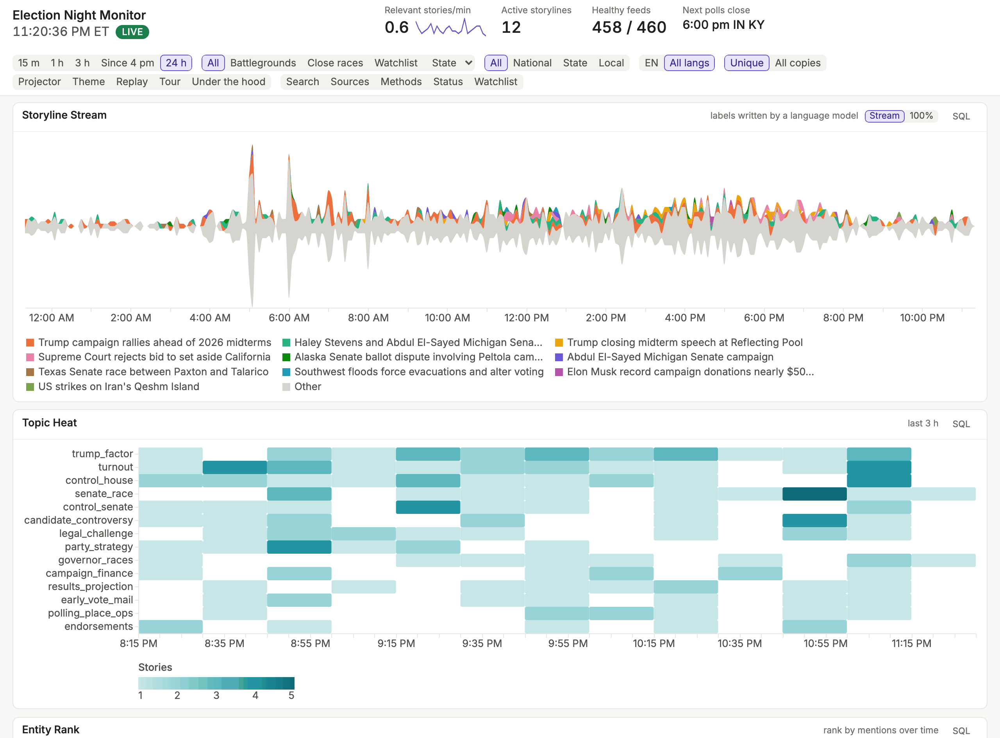
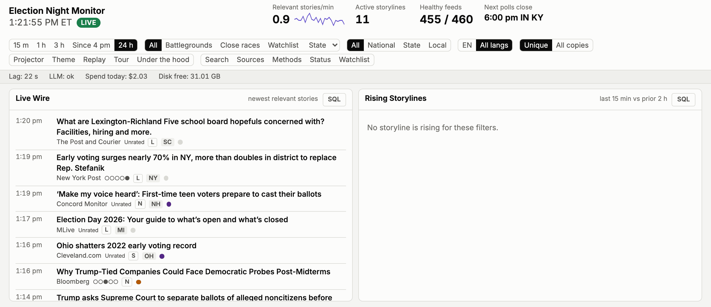
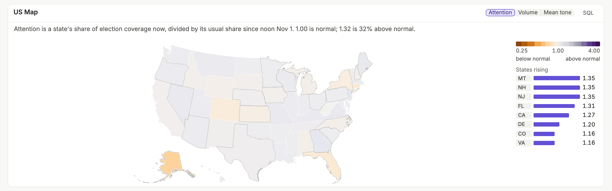
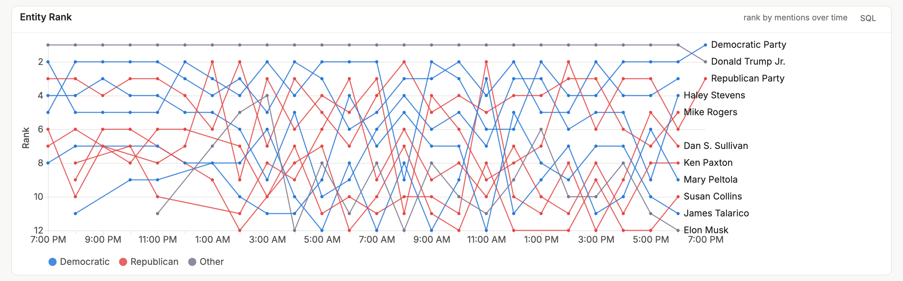
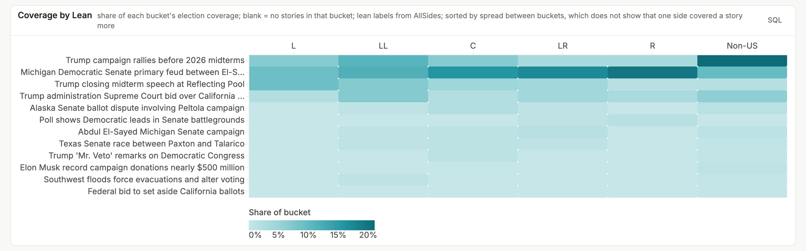
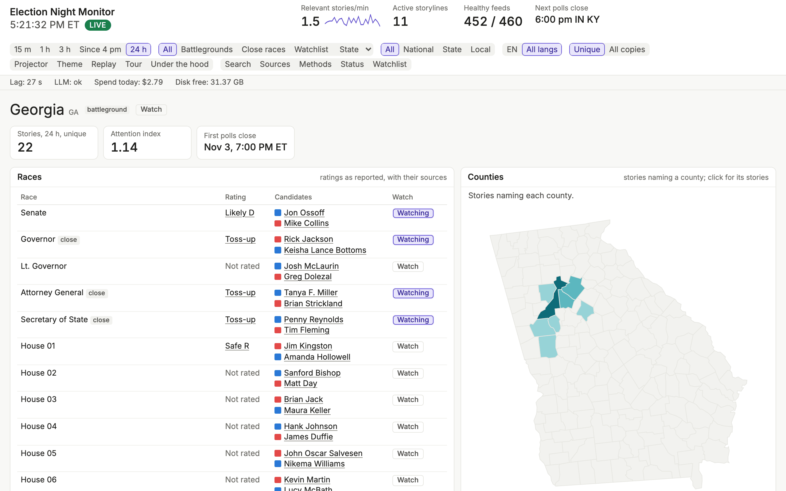
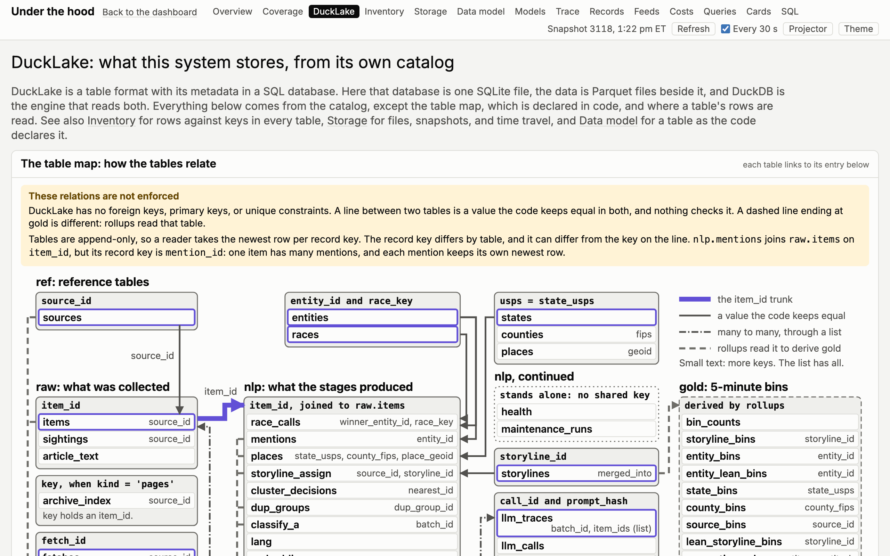
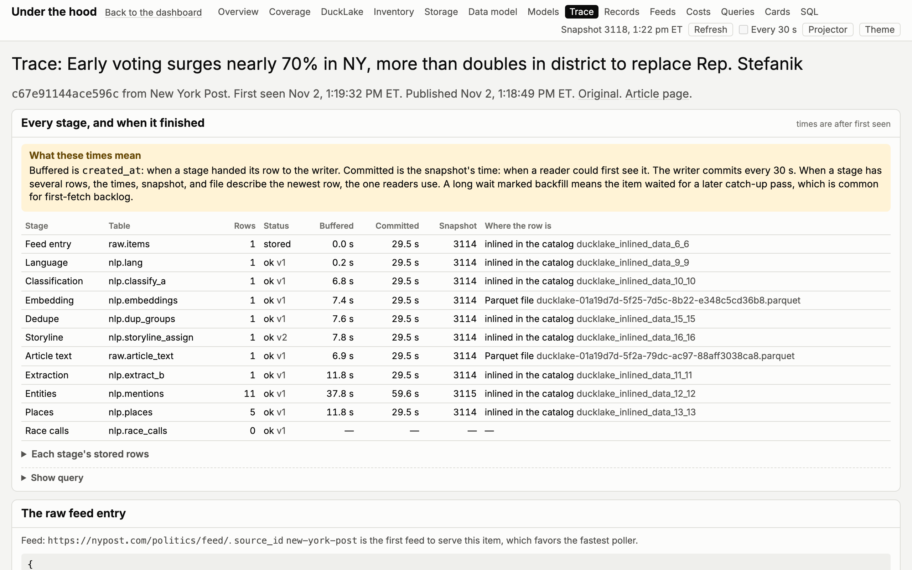
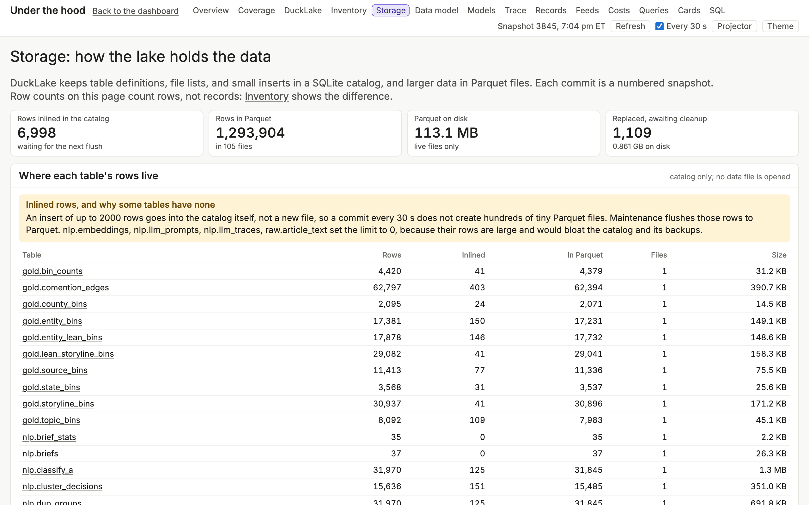
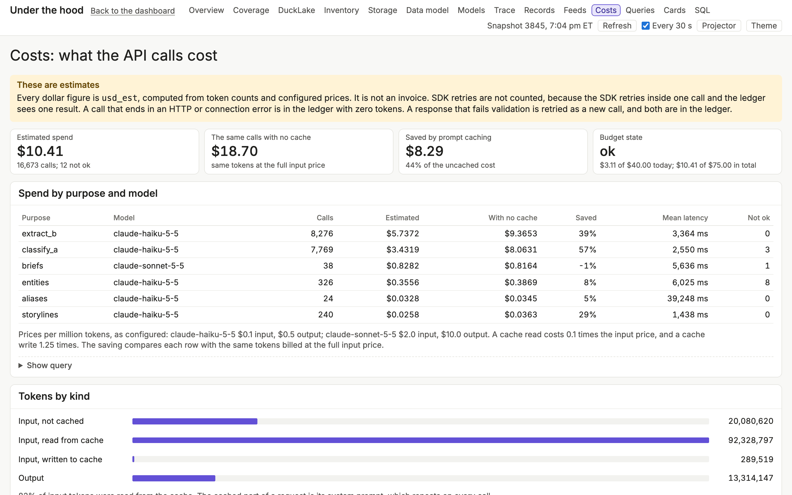

# Tour

These screens come from the running dashboard on November 2, 2026, the day
before the election, in a 1280×800 window. No polls had closed, so the charts
have no poll-closing lines. Select a screen to open it at full size.

Headlines come from the news outlets, with translations by a language model.
Language models write the briefs and the storyline labels and summaries, and
they produce most of the topics and all of the entities and tone. They can be
wrong. [Methods](methods.md) says how
each number is produced, and its limits.

## The dashboard

### Storylines and topics

The Storyline Stream shows the top storylines over the selected window, here 24
hours. The dashed lines mark a 39-minute network loss on the evening of
November 1. Topic Heat shows topics over the last 3 hours. The header holds the
window, the focus modes, and the other filters.

### The newest stories

The Live Wire lists the newest relevant stories, with each outlet's lean
rating, each story's level (N, S, or L for national, state, or local), and the
states a story names. Rising Storylines lists storylines that meet the rising
rule, and says so when none do. The strip under the header shows Lag, the
seconds since the last commit, with model state, spend today, and free disk.

### Attention by state

Attention compares a state's share of election coverage now with its usual
share. The list names the states rising most, by the last 15 minutes against
the 2 hours before them.

### Who is in the news

Entity Rank follows the 12 most-mentioned people and organizations over time,
with lines colored by party. A rank names the line that ended there last, so a
rank where no line ended has no name. Hover names the others.

### Coverage by outlet lean

Each cell is a storyline's share of one lean bucket's election coverage. The
columns run from left (L) through center (C) to right (R), followed by non-US
outlets. Lean labels are AllSides Media Bias Ratings.

The rows sort by the spread between buckets. A wide spread does not show that
one side of the press covered a story more, because the Left and Right buckets
hold few outlets.

### One state

A state's page lists its races, with ratings as reported and their candidates,
and maps the stories that name each county.

## Under the hood

These pages show the same data from the inside, for teaching.
[The class walkthrough](walkthrough.md) is the script for them.

### How the tables relate

The DuckLake page reads the lake's own catalog. Its table map shows the values
the code keeps equal across tables, which DuckLake does not enforce.

### One article, stage by stage

A trace follows one article through every stage: when each stage handed its row
to the writer, which snapshot committed it, and whether the row sits in the
catalog or in a Parquet file.

### How the lake holds the data

The Storage page counts the rows inlined in the catalog and the rows in
Parquet, by table.

### What the API calls cost

The Costs page shows estimated spend by purpose and model, and what prompt
caching saved. The figures come from token counts and configured prices. They
are not an invoice.
